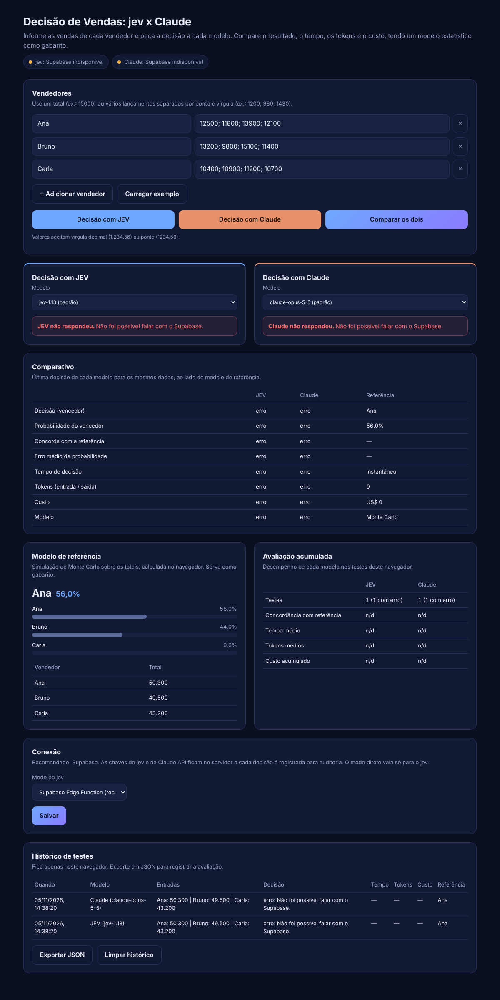

# Decisão de Vendas: jev x Claude

Aplicação para testar modelos de IA como motor de decisão: o usuário informa quanto cada vendedor vendeu e escolhe o modelo.

| Botão | O que mostra |
| :-- | :-- |
| **Decisão com JEV** (defapi.org, `jev-1.13`) | Decisão (vencedor e probabilidade de cada vendedor), tempo de decisão, tokens de entrada e saída, custo |
| **Decisão com Claude** (Claude API, `claude-opus-5-5`) | Os mesmos quatro itens |
| **Comparar os dois** | Roda os dois em paralelo e monta o comparativo lado a lado |

Toda decisão também é comparada com um **modelo de referência estatístico** (Monte Carlo), que serve de gabarito para dizer se cada modelo acertou.



## Arquitetura

```
Navegador (GitHub Pages)  ──►  Supabase Edge Function "jev-decisao"  ──►  jev (defapi.org)
  public/                         guarda JEV_API_KEY e ANTHROPIC_API_KEY ──►  Claude API
  referência calculada aqui       valida, limita uso, registra auditoria
                                  tabela jev_decisoes (RLS fechado)
```

| Peça | Onde | Papel |
| :-- | :-- | :-- |
| Front-end | `public/` publicado no GitHub Pages | Formulário, seletor de modelo, resultados, avaliação e histórico |
| Lógica compartilhada | `public/js/core.js`, `public/js/jev.js` | Validação, modelo de referência, prompt e leitura da resposta do jev |
| Backend | `supabase/functions/jev-decisao` | Chama o jev ou o Claude com as chaves guardadas nos secrets, mede tempo, tokens e custo, limita uso por origem, grava auditoria |
| Banco | `supabase/migrations` | Tabela `jev_decisoes` com RLS ativo e sem acesso público |
| Deploy | `.github/workflows/pages.yml` | Roda os testes e publica `public/` no Pages a cada push |

**Como cada métrica é medida**

| Métrica | Como |
| :-- | :-- |
| Decisão | Vencedor e probabilidades normalizadas (somam 100%) pela mesma função para os dois modelos |
| Tempo de decisão | Tempo da chamada ao modelo, medido no servidor. A tela também mostra o tempo de ida e volta no navegador |
| Tokens | `usage` devolvido por cada API. No Claude, os tokens de saída já incluem o raciocínio interno |
| Custo | Tokens x preço por milhão. Claude Opus 5.5: US$ 4 entrada e US$ 20 saída. jev: aparece "n/d" até você informar o preço em `JEV_PRECO_POR_MILHAO` |

**Configuração do Claude:** saída estruturada (JSON Schema) para garantir o formato, esforço `low` (decisão simples, menos tokens) e fallback automático do servidor caso um classificador de segurança recuse o pedido. Tudo ajustável por secrets.

**Modelos como escolha:** cada card tem seu seletor de modelo, alimentado pelos secrets `JEV_MODELOS` (padrão `jev-1.13`) e `CLAUDE_MODELOS` (padrão `claude-opus-5-5`). Para comparar outras versões, inclua os nomes separados por vírgula, por exemplo `claude-opus-5-5,claude-sonnet-5-5`.

**Dois modos de conexão** (card "Conexão com o jev"):
- **Supabase (recomendado):** a chave nunca chega ao navegador.
- **Direto do navegador:** para testes rápidos com sua própria chave. Só funciona se a API do defapi.org aceitar chamadas do navegador (CORS).

## Status do deploy

- [x] Tabela `jev_decisoes` criada no projeto Supabase **ClaudeProjects** (`xtrvojnauvkkterogrst`, São Paulo)
- [x] Edge Function `jev-decisao` publicada
- [x] Claude adicionado à Edge Function (versão 2) e colunas de tokens e custo na tabela
- [ ] Cadastrar as chaves do jev e da Claude API nos secrets do Supabase
- [ ] Ativar o GitHub Pages

## Passo a passo para colocar no ar

**1. Cadastrar as chaves no Supabase**

No painel do Supabase: Edge Functions, Secrets. Crie:

| Secret | Valor |
| :-- | :-- |
| `JEV_API_KEY` | sua chave do defapi.org |
| `ANTHROPIC_API_KEY` | sua chave da Claude API (console.anthropic.com) |
| `CLAUDE_MODELOS` | opcional. Padrão `claude-opus-5-5` |
| `CLAUDE_EFFORT` | opcional. Padrão `low` (`low`, `medium`, `high`, `xhigh`, `max`) |
| `JEV_PRECO_POR_MILHAO` | opcional. Preço do jev em USD por 1M tokens, no formato `entrada,saida` (ex.: `0.5,1.5`) |
| `JEV_API_URL` | opcional. Padrão `https://api.defapi.org/v1/chat/completions` (confirmar na documentação do defapi.org) |
| `JEV_MODELOS` | opcional. Padrão `jev-1.13` |
| `ALLOWED_ORIGINS` | opcional. Padrão `https://rodrigosilvacio.github.io,http://localhost:3000` |
| `LIMITE_POR_HORA` | opcional. Padrão `60` decisões por hora por origem |

Ou pelo terminal:

```bash
supabase secrets set JEV_API_KEY=sua-chave-jev ANTHROPIC_API_KEY=sua-chave-claude --project-ref xtrvojnauvkkterogrst
```

**2. Ativar o GitHub Pages**

No repositório: Settings, Pages, em "Build and deployment" escolha **Source: GitHub Actions**. Depois rode o workflow "Deploy GitHub Pages" em Actions (ou faça um push). O site fica em:

https://rodrigosilvacio.github.io/claude-jev/

Observação: GitHub Pages em repositório privado exige plano pago. Se o repositório for privado no plano gratuito, torne-o público.

## Desenvolvimento local

Requisito: Node.js 18 ou superior, sem dependências.

```bash
npm start
```

```bash
npm test
```

Se alterar `public/js/core.js` ou `public/js/jev.js`, sincronize a cópia da Edge Function (um teste falha se as duas divergirem):

```bash
npm run sync:supabase
```

```bash
supabase functions deploy jev-decisao --project-ref xtrvojnauvkkterogrst
```

## Como testar o modelo (roteiro sugerido)

1. **Caso óbvio:** 10000 / 50000 / 12000. Esperado: jev perto de 100% no maior.
2. **Empate técnico:** 10000 / 10200 / 9900. Esperado: probabilidades divididas.
3. **Volatilidade:** um vendedor estável (100; 101; 99) contra um volátil (10; 200; 5) com totais parecidos.
4. **Ruído de formato:** nomes com acento, valores com vírgula decimal, 5 ou mais vendedores.
5. **Consistência:** repetir o mesmo caso 5 vezes e ver se o jev muda a resposta.

Critério de aceite sugerido para o piloto: concordância no vencedor acima de 95% nos casos óbvios, zero respostas fora do formato JSON e latência média abaixo de 5 s. O histórico pode ser exportado em JSON pela tela, e a auditoria completa fica na tabela `jev_decisoes`.

## Governança e LGPD

- As chaves do jev e da Claude API ficam nos secrets do Supabase. O `public/js/config.js` contém apenas a URL e a chave anon do Supabase, que são públicas por design.
- A tabela `jev_decisoes` tem RLS ativo sem políticas: só a Edge Function (service role) grava e lê.
- O IP de quem usa não é salvo: guardamos apenas um hash truncado para aplicar o limite por hora.
- Nomes de vendedores são dados pessoais. Para testes, prefira apelidos ou códigos.
- A decisão do jev é apoio, não decisão final: mantenha revisão humana antes de qualquer efeito em comissão ou avaliação de desempenho.
- Limite conhecido do MVP: a chave anon é pública, então qualquer pessoa com o link pode consumir até `LIMITE_POR_HORA` chamadas por origem. Para produção, adicionar login (Supabase Auth) antes de liberar.

## Pendências

- [ ] Confirmar na documentação do defapi.org o endpoint exato e o formato da requisição do jev. O projeto assume o padrão chat completions compatível com OpenAI, com `Authorization: Bearer`. Se for diferente, ajuste `public/js/jev.js` e rode `npm run sync:supabase`.
- [ ] Rodar o roteiro de testes com as chaves reais nos dois modelos e registrar os resultados (botão "Exportar JSON").
- [ ] Confirmar o preço do jev e preencher `JEV_PRECO_POR_MILHAO` para o comparativo de custo ficar completo.
